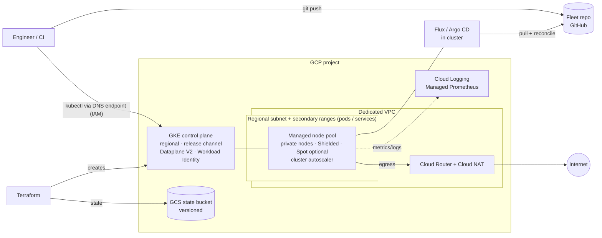

# GCP GKE Reference Platform

[](https://github.com/Tycho-1/gcp-gke-reference-platform/actions/workflows/ci.yml)
[](LICENSE)


Terraform for a **secure-by-default, private, regional GKE platform** on Google Cloud, handed off to **GitOps** (Flux or Argo CD).
A reusable GCP-only foundation module, `dev`/`prod` environments split into layers with separate state, and CI quality gates. It is the GCP sibling of [aws-eks-reference-platform](https://github.com/Tycho-1/aws-eks-reference-platform).

---

## Architecture



| Layer | Owned by | Path |
|-------|----------|------|
| Project APIs, VPC, NAT, GKE, node pools | Terraform module (GCP only) | [`terraform/modules/gke-foundation`](terraform/modules/gke-foundation) |
| Env opinions (sizing, Spot, zones, deletion protection) | `environments/<env>/10-foundation` | [`terraform/environments/`](terraform/environments) |
| GitOps bootstrap (Flux) | `environments/<env>/20-platform`, separate state | [`terraform/environments/`](terraform/environments) |
| Platform add-ons + apps | Git (Flux / Argo CD) | [`examples/flux-fleet-sample`](examples/flux-fleet-sample) |
| Remote state | GCS bucket | [`terraform/bootstrap`](terraform/bootstrap) |

`examples/*` GitOps folders are **templates for your fleet repo** (day-2 `git push`, not Terraform from this monorepo). Index: [`examples/README.md`](examples/README.md).

Deep dive: [`terraform/ARCHITECTURE.md`](terraform/ARCHITECTURE.md). Decisions: [`docs/adr/`](docs/adr/).

### Terraform layout (Google Cloud guidance)

Structure and style follow Google’s Terraform on Google Cloud best practices, especially [General style and structure](https://docs.cloud.google.com/docs/terraform/best-practices/general-style-structure?hl=en) (standard module layout, naming, variables/outputs, `terraform fmt`, examples with READMEs). Root-module and state patterns are summarized in [`terraform/README.md`](terraform/README.md) ([root modules](https://cloud.google.com/docs/terraform/best-practices/root-modules), [state in GCS](https://cloud.google.com/docs/terraform/resource-management/store-state)).

| GCP guidance (summary) | This repo |
|------------------------|-----------|
| Reusable module: `main.tf`, `variables.tf`, `outputs.tf`, README | [`terraform/modules/gke-foundation`](terraform/modules/gke-foundation) |
| Root configs per environment; don’t overload one state | `environments/<env>/10-foundation` + `20-platform` ([ADR 0007](docs/adr/0007-lifecycle-environments-and-layers.md)) |
| `project_id` and env-specific values via tfvars, not hidden defaults | `terraform.tfvars` per root; opinions as literals in env `main.tf` |
| Descriptive variables, typed outputs, resource-backed outputs | Module + env roots; `configure_kubectl_dns`, cluster name, etc. |
| Examples with READMEs | [`examples/`](examples/README.md) (fleet templates + optional Argo Terraform root) |
| Protect stateful / costly deletes | `deletion_protection` on prod cluster; destroy order documented |
| fmt + validate in workflow | CI + [`scripts/terraform-validate.sh`](scripts/terraform-validate.sh) |

**By design beyond the doc:** Kubernetes workloads and most add-ons are **not** in Terraform ([fleet GitOps](examples/flux-fleet-sample)); the `10` / `20` split avoids provider bootstrap issues on first apply ([`terraform/ARCHITECTURE.md`](terraform/ARCHITECTURE.md)).

---

## What this demonstrates

- **Terraform module design.** A GCP-only foundation module wraps pinned Google-maintained `terraform-google-modules`. Plan-time `check` blocks catch bad input combinations.
- **GKE security baseline** ([ADR 0006](docs/adr/0006-secure-by-default-gke.md)):
  - Private nodes, Dataplane V2 (eBPF NetworkPolicy), Workload Identity, and Shielded nodes.
  - GKE security posture and a dedicated node service account.
  - An IAM-gated DNS control-plane endpoint. `master_authorized_networks` has no default and warns on `0.0.0.0/0`.
- **GitOps handoff.** Terraform creates the cluster, then `flux_bootstrap_git` gives it to a fleet repo. Argo CD is the alternative ([ADR 0003](docs/adr/0003-one-gitops-tool-per-cluster.md)).
- **Operations defaults.**
  - The release channel manages upgrades, inside maintenance windows.
  - The cluster autoscaler and GKE-managed VPA handle scaling.
  - Managed Prometheus, Cloud NAT egress, and versioned GCS state are on by default.
- **CI quality gates** run on every PR:
  - `terraform fmt` and `validate` for all roots.
  - `tflint` with the Google ruleset.
  - Trivy IaC misconfiguration and secret scanning.
  - `kubeconform` on the manifests.
  - Dependabot for providers, modules, and actions.

---

## Quick start

**Prerequisites:** a GCP project with billing, Terraform ≥ 1.5, `gcloud` with `gke-gcloud-auth-plugin`, and `gcloud auth application-default login` ([auth guide](terraform/docs/gcp-authentication-for-terraform.md)). The module enables the required APIs itself.

```bash
# 0. once per project: state bucket
cd terraform/bootstrap && cp terraform.tfvars.example terraform.tfvars && terraform init && terraform apply
cp ../environments/backend.tfvars.example ../environments/backend.tfvars   # set bucket

# 1. foundation: VPC + GKE
cd ../environments/dev/10-foundation
cp terraform.tfvars.example terraform.tfvars      # project_id, master_authorized_networks (your /32)
terraform init -backend-config=../../backend.tfvars
terraform apply
$(terraform output -raw configure_kubectl_dns) && kubectl get nodes

# 2. platform: Flux bootstrap (push examples/flux-fleet-sample/ to GitHub first)
cd ../20-platform
cp terraform.tfvars.example terraform.tfvars      # project_id, flux_git_url
cp terraform.tfvars.secrets.example terraform.tfvars.secrets
terraform init -backend-config=../../backend.tfvars
terraform apply -var-file=terraform.tfvars.secrets
```

`prod` is the same flow in `environments/prod/`. Want Argo CD instead of Flux? Use [`examples/argocd-platform`](examples/argocd-platform/) as the platform layer. Details: [`terraform/environments/README.md`](terraform/environments/README.md).

**Verified on GCP (2026-10-08):** `dev/10-foundation` → `dev/20-platform` (Flux SSH bootstrap), existing fleet repo (e.g. Bank of Anthos), then destroy `20` → `10`. Earlier e2e on the legacy `gke-flux` root: 2026-09-22.

### Validate locally

```bash
bash scripts/terraform-validate.sh   # fmt -check + validate for every root
pre-commit install                   # optional: same checks on every commit
```

CI jobs (tflint, Trivy, kubeconform): [`.github/README.md`](.github/README.md).

---

## Cost

A running cluster costs money, so run `terraform destroy` when you're done.

With the `dev` shape, expect **roughly €3–8 per day**:
- one regional cluster;
- 0–3 `e2-standard-4` nodes (Spot);
- Cloud NAT.

Most of that is the cluster management fee (GKE's free-tier credit covers one cluster per billing account), plus the nodes and the NAT gateway. For real numbers, use the [pricing calculator](https://cloud.google.com/products/calculator). To lower the cost further:
- set `cluster_zones = ["europe-west4-a"]`;
- use a smaller `machine_type` in `dev/10-foundation/main.tf`.

`prod` (on-demand, multi-zone, min 1 node per zone) costs noticeably more.

---

## Repo layout

```
.
├── .github/                 # CI workflow + Dependabot
├── docs/adr/                # Architecture Decision Records
├── platform-requirements.md # capability matrix vs this repo
├── todolist.md              # roadmap (portfolio)
├── terraform/
│   ├── ARCHITECTURE.md      # module, IP plan, layers, security model
│   ├── bootstrap/           # GCS state bucket (once per project)
│   ├── docs/                # auth, remote state, troubleshooting
│   ├── modules/gke-foundation/
│   └── environments/
│       ├── dev/{10-foundation,20-platform}/
│       └── prod/{10-foundation,20-platform}/
├── examples/
│   ├── README.md            # fleet templates vs Terraform roots
│   ├── argocd-platform/     # Argo CD platform layer (alternative to Flux)
│   ├── flux-fleet-sample/   # fleet repo layout (primary)
│   ├── gitops-argocd-sample/
│   └── gitops-flux-sample/  # legacy
└── scripts/terraform-validate.sh
```

---

## Status and roadmap

| Area | Status |
|------|--------|
| VPC, Cloud NAT, private regional GKE, node pool autoscaling | ✅ |
| Secure defaults: Dataplane V2, posture, DNS endpoint, Workload Identity pool | ✅ |
| Flux bootstrap + fleet repo (layer split) | ✅ `dev/10` + `dev/20` on GCP **2026-10-08** |
| Argo CD via Helm + optional `Application` (example layer) | ✅ |
| GCS remote state, CI gates, ADRs | ✅ |
| Workload Identity Federation for CI, `plan` on PR | 📋 next |
| `dev` / `prod` environments, foundation / platform layers with separate state | ✅ ([ADR 0001](docs/adr/0001-module-and-environment-split.md)) |
| Artifact Registry, per-app Workload Identity, External Secrets + Secret Manager | 📋 P1–P2 |
| Hardened sample app, Gateway API + managed certs, HPA load test | 📋 P2 |
| Policy (Kyverno / Policy Controller), Cloud CDN | 📋 P4–P5 |

Full list: [`todolist.md`](todolist.md) · requirements: [`platform-requirements.md`](platform-requirements.md).

---

## AWS vs GCP sister repos

| | [aws-eks-reference-platform](https://github.com/Tycho-1/aws-eks-reference-platform) | This repo |
|--|--|--|
| Cluster | EKS | GKE Standard, regional |
| Node scaling | Karpenter | Cluster autoscaler ([ADR 0004](docs/adr/0004-cluster-autoscaler-not-karpenter.md)) |
| Dataplane | Cilium | Dataplane V2 (Google-managed Cilium) |
| GitOps | Flux | Flux (primary) or Argo CD |
| Layout | Terraform module + env | Same pattern |

---

## License

[MIT](LICENSE). This is reference code: review it before applying it to a real project.
