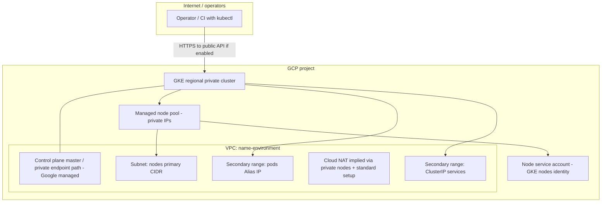
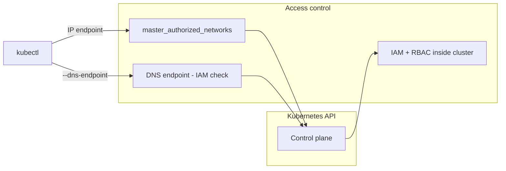

# Terraform — architecture and rationale

This document explains **what** the Terraform code provisions, **why** it is structured this way, and **how** the pieces fit together. It complements [`README.md`](README.md), [`modules/gke-foundation/README.md`](modules/gke-foundation/README.md), and the environment guide [`environments/README.md`](environments/README.md).

---

## 1. Goals

| Goal | How it is addressed |
|------|---------------------|
| **Reusable cluster baseline** | Logic lives in `modules/gke-foundation`; each env is a thin wrapper. |
| **VPC-native GKE baseline** | Dedicated VPC + subnet + secondary ranges for **Alias IPs** (pods/services); Google-managed **Dataplane V2** — no self-managed CNI. |
| **Secure by default** | Private nodes, Dataplane V2, security posture, Shielded nodes, Workload Identity, IAM-gated DNS endpoint; no open control plane default. See [ADR 0006](../docs/adr/0006-secure-by-default-gke.md). |
| **Familiar layout** | Same **module + environment** split as the sister [aws-eks-reference-platform](https://github.com/Tycho-1/aws-eks-reference-platform), implemented for **GCP / GKE**. |
| **No advanced node provisioning** | Single **managed node pool** with min/max; **no Karpenter**-style dynamic node provisioning in this repo. |
| **Cheap to run as a lab** | Spot nodes, single-zone option, `deletion_protection = false` — all explicit tfvars choices, not hidden defaults. |

---

## 2. Repository layout

```text
terraform/
  ARCHITECTURE.md            ← this file
  bootstrap/                 ← one-time GCS state bucket (per GCP project)
  docs/                      ← auth, remote state, troubleshooting
  modules/
    gke-foundation/          ← project APIs + VPC + NAT + GKE (reusable; GCP only)
      apis.tf / network.tf / main.tf / locals.tf / validations.tf / variables.tf / outputs.tf
  environments/
    backend.tfvars.example   ← state bucket shared by all layers
    dev/
      10-foundation/         ← module call with dev opinions (Spot, 0–3 nodes, no deletion protection)
      20-platform/           ← Flux bootstrap; cluster looked up by name
    prod/
      10-foundation/         ← same module; multi-zone, on-demand, deletion protection
      20-platform/           ← Flux bootstrap with NetworkPolicies
examples/argocd-platform/    ← alternative 20-platform layer (Argo CD via Helm)
```

**Three levels, three jobs:**

| Level | Answers | Example |
|-------|---------|---------|
| **Module** | *How* do we build a GKE foundation? | `modules/gke-foundation` |
| **Environment** (lifecycle stage) | *Which* opinions apply to dev vs prod? | `environments/prod/` |
| **Layer** (blast radius / state) | *What* can change together? | `10-foundation`, `20-platform` |

- **Environments are folders, not workspaces.** Each has its own state prefix (and, recommended, its own GCP project), so a `dev` command can never touch `prod`.
- **Layers are separate roots with separate state.** GCP resources (slow, rarely changed) are isolated from in-cluster bootstrap (fast, more often changed). `20-platform` finds the cluster with `data "google_container_cluster"`, so every root applies in one normal `terraform apply`, with no `-target`.
- **Environment opinions are literals** in `10-foundation/main.tf`. Diffing dev against prod shows every difference, and each one is code-reviewed.

**One GitOps tool per cluster:** Flux (`20-platform`) *or* Argo CD (`examples/argocd-platform`), never both.

---

## 3. High-level architecture

### 3.1 Diagram



**Notes:**

- The **control plane** is operated by Google; you choose **public vs private API** and **authorized networks**.
- **Worker nodes** run in your **subnet** with **private IPs** when `enable_private_nodes = true`.
- **Pods** consume IPs from the **pods secondary range**; **ClusterIP services** use the **services secondary range** (VPC-native / Alias IP model).

### 3.2 IP addressing (conceptual)

| Range role | Typical variable | Purpose |
|------------|------------------|---------|
| Node / subnet | `subnet_cidr` | GKE nodes’ primary NIC addresses in the VPC. |
| Pods | `pods_cidr` + range name `ip-range-pods` | Pod IPs (Alias IPs), routable within VPC semantics. |
| Services | `services_cidr` + range name `ip-range-svc` | Internal Kubernetes services (ClusterIP range). |
| Master | `master_ipv4_cidr_block` | **Private** /28 for the managed control plane endpoint peering (not your workload CIDRs). |

Ranges must **not overlap**. The default `172.16.0.0/28` for the master is separate from the `10.x` node/pod/service space in the examples.

---

## 4. What each component does

### 4.0 Why “modules inside the module”? (`terraform-google-modules/*`)

The inner pieces are **not** random community snippets. They come from the **[`terraform-google-modules`](https://github.com/terraform-google-modules)** GitHub org: **Google-maintained, open-source Terraform modules** for GCP (published on the **HashiCorp Registry**). They are the de facto standard way to compose VPC, GKE, Cloud SQL, etc., in Terraform—similar in spirit to AWS’s **terraform-aws-modules**.

| Question | Answer |
|----------|--------|
| **Who maintains them?** | Google (and contributors) under `terraform-google-modules`; they track GCP API changes and common GKE/VPC patterns. |
| **Why use them instead of raw `google_*` resources?** | **Less boilerplate** and fewer foot-guns: VPC-native GKE needs matching **subnet secondary range names**, **private cluster** master CIDR, node service accounts, node pools, etc. The upstream modules encode patterns that match **Google’s own docs** and support forums. |
| **Why wrap them again in `gke-foundation`?** | Your repo gets a **small, stable contract** (`name`, `environment`, CIDRs, node sizes) instead of exposing every knob of two large upstream modules. You **pin versions** in one place: **network 18.2.0**, **private-cluster 45.0.0**. |
| **Downside?** | You inherit upstream **opinions** and occasional **breaking changes** on major bumps—so version pins and reading their changelogs matter. |

So: **inner modules = Google’s reusable building blocks**; **outer module = your team’s opinionated “standard cluster” façade**.

### 4.1 `modules/gke-foundation/network.tf`

| Piece | What it does |
|-------|----------------|
| **`terraform-google-modules/network`** | Creates a dedicated **VPC** named `{name}-{environment}` and a **regional subnet** for the cluster. |
| **Primary subnet** | Holds **node** primary IPs; optional **Private Google Access** (`subnet_private_access`) so nodes without public IPs can reach Google APIs (GCR, Artifact Registry, etc.). |
| **Secondary ranges** | Two ranges on the same subnet: **`ip-range-pods`** and **`ip-range-svc`**, wired by name into the GKE module. This is the standard **VPC-native GKE** pattern. |
| **`google_compute_router` + `google_compute_router_nat`** | When **`enable_cloud_nat`** is `true` (default), creates **Cloud Router + Cloud NAT** with `ALL_SUBNETWORKS_ALL_IP_RANGES` so **private nodes** get **general internet egress** (not only Google APIs via Private Google Access). Skipped on Shared VPC. |

**Why not the “default VPC”?** A dedicated VPC avoids accidental coupling to legacy default subnets, makes CIDR planning explicit, and matches how platform teams usually isolate Kubernetes.

### 4.2 `modules/gke-foundation/main.tf`

| Setting | Meaning |
|---------|---------|
| **`private-cluster` submodule** | Implements a **private nodes** cluster with a Google-managed master; options for public vs fully private API. |
| **`regional = true`** | Control plane and nodes spread across **multiple zones** in the region (higher availability than a single zone). |
| **`kubernetes_version`** | Default **`latest`**: the **release channel** owns upgrades. An exact version only sets a *floor* (`min_master_version`) — the channel still upgrades past it, so exact pins create drift, not stability. Use **maintenance windows / exclusions** to control timing. |
| **`release_channel`** | `REGULAR` / `STABLE` / etc. — how fast the cluster receives upgrades. |
| **`enable_private_nodes`** | Nodes only get **internal** IPs (typical for production). |
| **`enable_private_endpoint`** | If `true`, API is only reachable from allowed private paths (more secure, more setup). Default **`false`** keeps a **public** endpoint for simpler `kubectl` from laptops (still gated by **authorized networks** when configured). |
| **`master_authorized_networks`** | **Only listed CIDRs** may reach the **IP** endpoint. No default in the environments — you must set your own `/32` or VPN range. A `check` block warns if `0.0.0.0/0` is used. |
| **`enable_dns_endpoint`** (default `true`) | Adds the **DNS-based control plane endpoint**: every request is authorized by **IAM**, not source IP. `gcloud container clusters get-credentials … --dns-endpoint` works from anywhere without widening authorized networks. |
| **`master_ipv4_cidr_block`** | Reserved /28 for the **hosted master** network (Google-side peering). |
| **`deletion_protection`** | Prevents accidental `terraform destroy` of the cluster when `true`. |
| **`datapath_provider = ADVANCED_DATAPATH`** | **Dataplane V2** (eBPF, Google-managed Cilium). Enforces **Kubernetes NetworkPolicy natively** and adds policy logging. |
| **`network_policy = false`** | That flag is the **legacy Calico add-on** — incompatible with Dataplane V2 (a `check` block rejects the combination). |
| **`security_posture_mode = BASIC`** | GKE security posture dashboard: workload configuration audit at no extra cost. |
| **Image streaming + gVNIC** | Node pool defaults `enable_gcfs = true` (faster pod start for large images) and `enable_gvnic = true` (higher network throughput). |
| **Managed Prometheus** | `monitoring_enable_managed_prometheus = true` — managed collection is ready; only billed once `PodMonitoring` resources scrape metrics. |
| **`enable_apis`** (default `true`) | `google_project_service` enables Compute, Kubernetes Engine, IAM, Logging, Monitoring, Resource Manager so a clean project works on first apply. |
| **`remove_default_node_pool` + custom `node_pools`** | Drops the tiny default pool and creates **one explicit pool** (machine type, disk, autoscaling min/max, spot option). |
| **`create_service_account = true`** | GKE uses a **dedicated GCP service account** for nodes; you grant IAM to that SA for GCS, Pub/Sub, etc. |
| **`identity_namespace = "enabled"`** (default) | Enables the **Workload Identity pool** (`[project_id].svc.id.goog`). **Per-app IAM bindings** (K8s SA → GCP SA) belong in the **environment** or fleet repo — not in this module. |
| **`cluster_resource_labels` / `node_pools_labels` / `node_pools_tags`** | Cost allocation, operations, and firewall targeting. |
| **`add_cluster_firewall_rules`** | When `true` (default), enables upstream **private-cluster** firewall rules (intra-cluster egress, master→webhooks) — important for **restrictive VPC** egress policies. |
| **`depends_on` NAT** | GKE submodule waits on **`google_compute_router_nat`** when NAT is enabled so node bootstrap does not race **missing SNAT**. |

**What is *not* configured here**

- **No GKE Autopilot** — you manage a **node pool** explicitly.
- **No self-managed CNI** — uses GKE’s **VPC-native (Alias IP)** networking with Google-managed **Dataplane V2**; no Cilium/Calico Helm install to operate.
- **No Karpenter** — scaling is **GKE managed node pool** behaviour only (see §4.3).
- **No separate `cluster_autoscaling` block** (multi-pool / node auto-provisioning profiles) — not exposed in this thin module; only the **single pool’s** `min_count` / `max_count` via upstream `terraform-google-modules/kubernetes-engine`.

### 4.3 Node pool: `min_node_count`, `max_node_count`, and Cluster Autoscaler

You set **`machine_type`**, **`min_node_count`**, **`max_node_count`**, and **`initial_node_count`** in the module. Those map to the **managed node pool** created by `terraform-google-modules/kubernetes-engine`.

| Topic | Detail |
|-------|--------|
| **What min/max mean** | They are the **allowed range** for the **size of that node pool**: “never fewer than `min`, never more than `max`” (per how GKE regional pools and the module interpret counts). |
| **What changes the count inside that range** | GKE’s **Cluster Autoscaler** for **autoscaling node pools**. It reacts mainly to **scheduling pressure** — e.g. **Pending** pods that cannot fit on existing nodes for **CPU/memory** — and adds or removes nodes between **min** and **max**. |
| **Relation to “cluster autoscaler”** | You do not enable a separate Helm “cluster autoscaler” chart here. For **managed node pools** with min/max, scaling is **built into GKE**; **min/max are the knobs for that autoscaler** on this pool. |
| **If `min_node_count == max_node_count`** | The pool **cannot** scale up or down; size is **fixed** at that value (even if autoscaling is configured with a zero-width range). |
| **What it does *not* do** | It does **not** resize **VM machine type** — only **node count**. It does **not** scale because “CPU is high” unless that leads to **new pods that cannot be scheduled**. **HPA** can create more pods, which can then trigger **more nodes** if they stay Pending. |
| **`initial_node_count`** | Used especially at **pool/cluster creation**; ongoing bounds for scaling are **min** / **max**. For **regional** clusters, interpret “per zone” semantics per GKE / module docs. |
| **`spot`** | Cheaper lab nodes; GCP may reclaim them. Prefer **`false`** for stable demos and prod. |
| **`node_pool_queued_provisioning`** | Optional GKE queued provisioning for stockout scenarios; default **`false`**. See `variables.tf` if you enable it. |

### 4.4 Vertical Pod Autoscaling (VPA)

| Topic | Detail |
|-------|--------|
| **Cluster flag** | `enable_vertical_pod_autoscaling = true` (default in `gke-foundation`) sets **`verticalPodAutoscaling.enabled`** on the GKE cluster via upstream `private-cluster`. |
| **What GKE installs** | **Managed VPA components** (recommender, updater, admission plugin as applicable for your GKE version) — not a separate Helm release in this repo. |
| **What you still add in Git** | **`VerticalPodAutoscaler`** CRs targeting specific Deployments/StatefulSets (fleet repo). Without CRs, VPA is **available** but does not resize workloads. |
| **vs Cluster Autoscaler** | VPA adjusts **pod resource requests**; Cluster Autoscaler adjusts **node count** when pods cannot schedule. |
| **vs HPA** | HPA scales **replica count**; VPA scales **CPU/memory per pod**. They can be combined with care (avoid both controlling the same metric). |

**Typical lab apply:** ~**20 GCP resources** (6 project APIs, VPC, subnet, router, NAT, cluster, node pool, 2 firewall rules, node SA + IAM bindings).

---

## 5. Environment layers

See [`environments/README.md`](environments/README.md) for the apply order and a dev vs prod comparison.

### 5.1 `10-foundation`

| File | Role |
|------|------|
| `main.tf` | `module "gke_foundation"` with the environment's CIDRs, sizing, Spot, zones, deletion protection |
| `variables.tf` | Per-user values only: `project_id`, `region`, `master_authorized_networks` (+ `cluster_zones` in dev) |
| `providers.tf` / `versions.tf` | `google` + `google-beta` (required by the network module) |
| `backend.tf` | `backend "gcs"` with a hard-coded prefix `<env>/10-foundation` |
| `outputs.tf` | `cluster_name` (input for `20-platform`), `configure_kubectl_dns`, WI pool, node SA |

### 5.2 `20-platform` (Flux)

| File | Role |
|------|------|
| `providers.tf` | `data "google_container_cluster"` by name → `kubernetes` + `flux` providers. Connects through the IAM-gated **DNS endpoint** (publicly trusted cert, no CA; works from CI without IP allowlisting). `use_dns_endpoint = false` falls back to IP endpoint + CA |
| `flux.tf` | `flux-system` namespace, `terraform-outputs` ConfigMap (cluster facts for post-build substitution), `flux_bootstrap_git` (PAT or SSH variant) |
| `validations.tf` | Plan-time checks: PAT or SSH key present for the chosen auth mode |
| `terraform.tfvars.secrets.example` | `github_token` or SSH key, **never committed** |

After bootstrap, **platform add-ons and apps** live in the **fleet repo** (`clusters/platform-ref-gke-<env>/`, `apps/`), not in Terraform.

### 5.3 Alternative: Argo CD platform layer

[`examples/argocd-platform/`](../examples/argocd-platform/) is a drop-in replacement for `20-platform`. It uses the same cluster lookup and connection pattern, then installs Argo CD with the Helm provider (pinned chart, [values file](../examples/argocd-platform/helm/argocd-values.yaml): TLS, limits, Dex/exec off) and an optional `Application` for commit-to-deploy.

| | Flux (`20-platform`) | Argo CD (`examples/argocd-platform`) |
|--|--|--|
| Install | `flux_bootstrap_git`: Git owns `flux-system/` | `helm_release` in Terraform |
| Workloads | Fleet repo Kustomize | `Application` CR → Git path |
| After day 1 | Terraform rarely touched | Next step: Argo manages itself (app-of-apps) |

### 5.4 Should add-ons live *inside* the GKE module?

| Approach | Good fit | Downsides |
|----------|----------|-----------|
| **GCP-only module + separate platform layer** (this repo) | Reusable foundation; teams pick Flux, Argo, or nothing | One more root to apply |
| **Fat "platform" module** (VPC + GKE + GitOps) | One team ships a fixed golden path | Couples Google + Kubernetes providers and bootstrap ordering; bigger blast radius |
| **GitOps installs itself** (Terraform only makes the cluster) | Terraform never holds in-cluster state | Chicken-and-egg on first install; usually a one-off script |

Reusable modules should stick to **one blast radius**. Anything needing Kubernetes/Helm credentials has a different lifecycle and owner, so it belongs in its own root.

---

## 6. Security and operations (mental model)



- **Network**: `master_authorized_networks` is your **first line** for who can hit the **IP** endpoint; the **DNS endpoint** replaces source-IP checks with **IAM** on every request.
- **Identity**: Human access is usually **`gcloud` + IAM**; workloads use **Workload Identity** — the module enables the **WI pool** (`identity_namespace`); **bindings** per K8s ServiceAccount are environment/app scope (see [`modules/gke-foundation/README.md`](modules/gke-foundation/README.md)).
- **Nodes**: Private nodes reduce **exposure** of the data plane; **Cloud NAT** (in `network.tf` when `enable_cloud_nat = true`) provides outbound internet from private nodes.

---

## 7. How this differs from the AWS sister repo

| Topic | [aws-eks-reference-platform](https://github.com/Tycho-1/aws-eks-reference-platform) | This repo (GCP) |
|-------|----------------------------------|-------------------------|
| Cloud | AWS | **GCP** |
| Kubernetes | EKS | **GKE** |
| CNI / dataplane | Cilium (primary env) | **VPC-native + Dataplane V2** (Google-managed Cilium) |
| Nodes | Karpenter + node groups | **Managed node pool** + cluster autoscaler |
| GitOps | Flux (`cilium-karpenter` env) | **Flux** (`<env>/20-platform`) or **Argo CD** (`examples/argocd-platform`) |
| Terraform layers | AWS + k8s/helm/flux | `10-foundation`: **google + google-beta**; `20-platform`: **kubernetes + flux** |

---

## 8. Suggested next steps (out of scope here)

- **Version-pinned modules** in prod (`source = "git::…?ref=vX.Y.Z"`) so dev can test module changes first.
- **Per-app Workload Identity** bindings (ESO, demo app) via upstream `workload-identity` submodule in environment TF.
- **Artifact Registry** + CI deploy pipeline (GHA; see `todolist.md` P3).
- **Private endpoint only** + **VPN / IAP / bastion** for prod API access.
- **Gateway API / cert-manager / ESO** in fleet repo — not in foundation module.

**Already in repo:** `terraform/bootstrap/` (GCS bucket), Cloud NAT in module, dual GitOps envs, `examples/flux-fleet-sample/`.

---

## 9. Quick reference: file → responsibility

Module-level **inputs, outputs, usage snippet, and “out of scope”**: [`modules/gke-foundation/README.md`](modules/gke-foundation/README.md).

| Path | Responsibility |
|------|----------------|
| `modules/gke-foundation/versions.tf` | Terraform and **hashicorp/google** version constraints. |
| `modules/gke-foundation/variables.tf` | All **module inputs** and defaults. |
| `modules/gke-foundation/locals.tf` | **Node pool** merge defaults (`default_node_pool`). |
| `modules/gke-foundation/validations.tf` | Plan-time **checks** (Shared VPC, Cilium, input consistency). |
| `modules/gke-foundation/network.tf` | **VPC + subnet + secondary ranges + Cloud Router + Cloud NAT**. |
| `modules/gke-foundation/main.tf` | **GKE cluster + node pool** via upstream **private-cluster** module. |
| `modules/gke-foundation/outputs.tf` | Values for CI, docs, downstream modules (`configure_kubectl`, `workload_identity_pool`). |
| `bootstrap/main.tf` | **GCS state bucket** (once per project). |
| `environments/<env>/10-foundation/main.tf` | Module call with that environment's opinions. |
| `environments/<env>/20-platform/providers.tf` | Cluster lookup + **Kubernetes / Flux** providers (DNS endpoint). |
| `environments/<env>/20-platform/flux.tf` | **flux_bootstrap_git** + cluster-facts ConfigMap. |
| `examples/argocd-platform/argocd*.tf` | Alternative platform layer: **Argo CD** Helm release + optional `Application`. |

This should be enough to **onboard a teammate** without reading every line of HCL. Key decisions are recorded as ADRs in [`../docs/adr/`](../docs/adr/).
